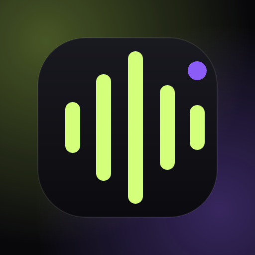
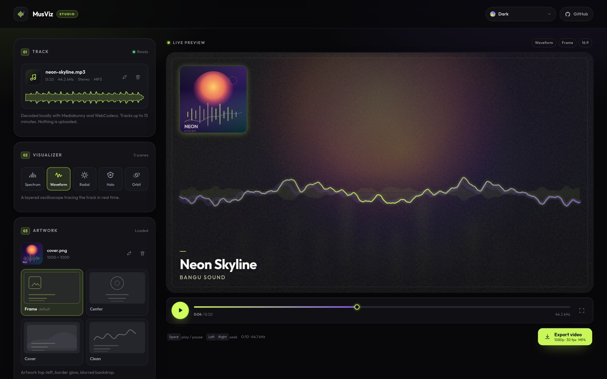
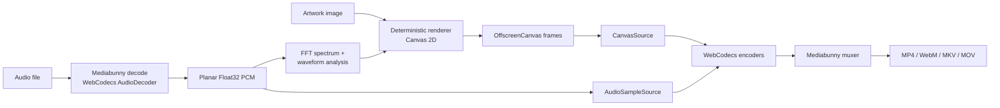
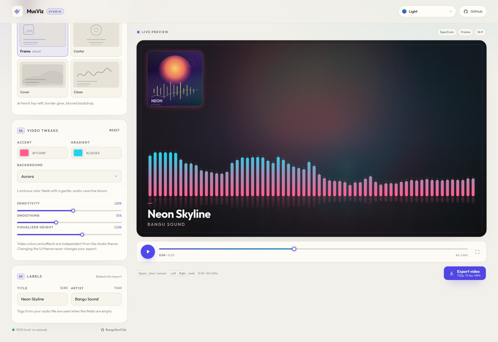

<div align="center">
  
  <h1>MusViz</h1>
  <p><strong>Turn any track into a studio-grade music visual.</strong></p>
  <p>Upload audio and artwork, pick a scene, and export a finished music video up to 4K at 60 fps.<br />Everything runs in your browser — no uploads, no account, no server.</p>

  <p>
    <a href="https://bangudevclub.github.io/musviz/"><strong>Live app</strong></a>
    &nbsp;·&nbsp;
    <a href="https://github.com/BanguDevClub/musviz">GitHub</a>
    &nbsp;·&nbsp;
    <a href="https://github.com/BanguDevClub/musviz/issues">Issues</a>
  </p>
</div>

<p align="center">
  <a href="LICENSE"></a>
  <a href="https://react.dev"></a>
  <a href="https://mediabunny.dev"></a>
  <a href="https://developer.mozilla.org/docs/Web/API/WebCodecs_API"></a>
</p>

<p align="center">
  <a href="https://bangudevclub.github.io/musviz/">
    
  </a>
</p>

## Why MusViz

Most browser visualizers capture a canvas in real time, then hand you a stuttery, low-resolution recording. MusViz treats the visual like a video render:

- **Deterministic rendering.** The exact same `VisualizerRenderer` powers the live preview and the export worker. A frame at 3.2 s looks the same in a 720p preview and a 4K master.
- **Offline-speed encoding.** No screen capture, no waiting in real time. Frames are drawn as fast as the encoder accepts them through Mediabunny's backpressure-aware `CanvasSource`.
- **Truly local.** Decoding, analysis, drawing, encoding, and muxing all happen in the tab. Your media never touches a server.
- **Codec freedom.** Every codec allowed by the selected Mediabunny container is listed. MusViz probes the browser's WebCodecs encoders at your chosen resolution and frame rate, then enables what can actually encode.

## Features

- **Five reactive scenes** — Spectrum bars with reflections, a layered oscilloscope, a radial spectrum, a polar halo, and an orbiting constellation.
- **Four artwork layouts** — `Frame` (the default: bordered artwork top-left plus a blurred backdrop), `Center`, `Cover`, and `Clean`.
- **Your labels, baked in** — track title and artist fields, pre-filled from the file's metadata tags or filename when possible.
- **Six interface themes** — Dark, Light, and the four Catppuccin variants: Latte, Frappé, Macchiato, and Mocha. They style the studio only; the video keeps its own palette.
- **Video color lab** — accent and gradient colors, four background treatments, sensitivity, temporal smoothing, and visualizer height. Persisted independently of the interface theme and baked into every export.
- **Export up to 4K** — 720p, 1080p, 1440p, and 2160p at 15, 30, or 60 fps.
- **Every supported format** — MP4, WebM, Matroska (`.mkv`), and QuickTime (`.mov`), with H.264, HEVC, VP8, VP9, AV1, ProRes, AAC, Opus, MP3, Vorbis, FLAC, AC-3/E-AC-3, DTS, TrueHD, PCM, μ-law/A-law where the browser and container allow them.
- **Two delivery modes** — a normal browser download, or direct-to-disk streaming through the File System Access API for large 4K files.
- **Worker-based exports** — the UI stays responsive while a background worker renders, encodes, and muxes with live progress and cancellation.
- **No account, no uploads, no analytics.**

## Quick start

Requires **Node.js 22.12+** and npm.

```bash
git clone https://github.com/BanguDevClub/musviz.git
cd musviz
npm install
npm run dev
```

Open **http://localhost:5173/musviz/**.

Production build:

```bash
npm run build
npm run preview
```

The project is deployed at [bangudevclub.github.io/musviz](https://bangudevclub.github.io/musviz/). The Vite base path is `/musviz/`; see [Deployment](#deployment) if you fork it.

## Scripts

| Command                | What it does                                                |
| ---------------------- | ----------------------------------------------------------- |
| `npm run dev`          | Vite dev server at `/musviz/`                               |
| `npm run build`        | Regenerate brand assets, then build the static site         |
| `npm run preview`      | Serve the production build locally                          |
| `npm run typecheck`    | TypeScript project check (`tsc -b`)                         |
| `npm run lint`         | ESLint over the TypeScript/React sources                    |
| `npm run lint:fix`     | ESLint with automatic fixes                                 |
| `npm run format`       | Prettier over the repository                                |
| `npm run format:check` | Verify Prettier formatting without writing files            |
| `npm run check`        | `typecheck` + `lint` + `format:check`                       |
| `npm run validate`     | `check` + production build (the CI gate)                    |
| `npm run assets`       | Regenerate OG image, PWA icons, and favicon from `scripts/` |
| `npm run clean`        | Remove `dist` and local Vite/TypeScript caches              |
| `npm run reinstall`    | Remove `node_modules` and the lockfile, then reinstall      |
| `npm run ci`           | `npm ci` followed by `validate`                             |

## How it works



### Decoding & analysis

Audio is decoded with Mediabunny's `AudioBufferSink`, which wraps WebCodecs and yields planar float PCM. MusViz then uses a 2048-point Hann-window FFT with 72 logarithmically spaced bands. Spectrum values are normalized in decibels and lightly tilted toward the highs so a mix reads across the entire bar row. The waveform uses deterministic auto-gain, so quiet masters still produce a readable oscilloscope without changing between preview and export.

Only the first two channels are kept for preview/visualization, and tracks are capped at **15 minutes** because the decoded PCM stays in memory for instant seeking.

### The renderer

`src/visualizer/renderer.ts` owns the whole composition:

1. Background and artwork caches (gradients, blurred image layer, vignette, film grain, rounded artwork card).
2. The active scene, drawn from the current time's spectrum and waveform.
3. Title and artist typography with the bundled Outfit variable font.
4. A final inset frame and label accents.

The video is composed from a fixed dark base palette plus the user's accent and gradient colors. The React interface theme is deliberately absent from `RenderConfig`, so a UI theme switch cannot dirty the canvas or enter the export worker.

Nothing in the render loop depends on wall-clock time or randomness. The preview canvas and the export worker instantiate the same class at different resolutions, so composition, colors, and text wrapping scale with the output frame.

### Exporting

The export dialog probes encoder support live:

- The selected container determines the candidate codecs via `OutputFormat.getSupportedVideoCodecs()` and `getSupportedAudioCodecs()`.
- MusViz calls `getEncodableVideoCodecs` / `getEncodableAudioCodecs` at your resolution, frame rate, and quality. Unavailable codecs stay visible but disabled, so you can see exactly what the browser can do.
- On export, a module worker receives copies of the PCM channels, the artwork `File`, and the render config.
- Audio is encoded first with `AudioSampleSource` (it is the smaller payload), then each frame is drawn into an `OffscreenCanvas` and passed to `CanvasSource` while awaiting backpressure.
- The muxer writes to a `BufferTarget` for downloads, or a `StreamTarget` backed by a `FileSystemFileHandle` for direct-to-disk exports.
- `AudioSampleSource` resamples to 48 kHz where needed. PCM codecs skip the quality setting; compressed codecs use MusViz's high-quality preset.
- Progress and cancellation are message-driven; a new worker is created for each export and terminated when it finishes.

### Project layout

```text
src/
├── App.tsx                 # Project state, uploads, keyboard shortcuts
├── components/             # Shell, upload panels, stage, transport, export dialog
├── export/                 # Worker protocol and main-thread export client
├── hooks/                  # Web Audio playback + theme persistence
├── lib/                    # Decode, FFT, codec probing, export settings, video style, formatting
├── styles/                 # Theme tokens + UI styles
├── visualizer/             # Deterministic renderer, primitives, scenes
├── workers/export.worker.ts
└── types.ts
scripts/
├── fonts/                  # Static Outfit instances used only by asset generation
└── generate-assets.mjs     # OG image, PWA icons, favicon
public/                     # Generated icons, manifest, OG image, robots, sitemap
docs/screenshot.jpg         # README preview
```

React is the only UI abstraction: no state library, no component kit, no CSS framework. The production dependencies are exactly **react**, **react-dom**, and **mediabunny**.

## Codecs

Containers and typical codecs offered in the app:

| Container | Extension | Video                            | Audio                                                                 |
| --------- | --------- | -------------------------------- | --------------------------------------------------------------------- |
| MP4       | `.mp4`    | AVC, HEVC, VP8, VP9, AV1, ProRes | AAC, Opus, MP3, Vorbis, FLAC, AC-3, E-AC-3, DTS, TrueHD, PCM variants |
| WebM      | `.webm`   | VP8, VP9, AV1                    | Opus, Vorbis                                                          |
| Matroska  | `.mkv`    | All of the above                 | All of the above plus additional PCM variants                         |
| QuickTime | `.mov`    | All of the above                 | All of the above plus 8-bit PCM, μ-law, and A-law                     |

This follows [Mediabunny's format and codec support](https://mediabunny.dev/guide/supported-formats-and-codecs). **Container support does not guarantee an encoder exists in your browser.** Chrome/Chromium builds differ on H.264, HEVC, AAC, and ProRes. If a codec is greyed out, your browser cannot encode it on this machine. MusViz auto-selects an available codec after each container or resolution change.

Quality presets are Standard, High, and Master. They map to Mediabunny's `Quality` class, which adapts bitrate to codec, resolution, and frame rate. Audio uses the high-quality preset for compressed codecs and retains full PCM resolution for PCM codecs.

## Video look & interface themes

The studio and the video have separate color systems. The **interface theme** only styles the app shell. The video always renders on its own cinema-dark base, so switching the studio to Light, Latte, or Mocha never changes a single frame of your export.

The video's look is controlled entirely from **Video tweaks**:

[](https://bangudevclub.github.io/musviz/)

| Control           | Range                              | What it changes                                                                                                  |
| ----------------- | ---------------------------------- | ---------------------------------------------------------------------------------------------------------------- |
| Accent color      | Any hex color                      | Primary visualizer color, artwork glow, text accent, and background glow.                                        |
| Gradient color    | Any hex color                      | Second visualizer color, bar gradients, aurora light, and background wash.                                       |
| Background        | Ambient · Aurora · Grain · Minimal | Artwork haze and grain treatment. Aurora adds an audio-reactive color bloom; Grain is a high-contrast film look. |
| Sensitivity       | 0.10–4.00×                         | Spectrum gain. Pushes quiet detail up or tames hot masters.                                                      |
| Smoothing         | 0–1                                | Deterministic temporal smoothing using fixed 60 Hz taps, so preview and export match.                            |
| Visualizer height | 0.10–3.00×                         | Bar, waveform, ring, and orbit amplitude.                                                                        |

Sensitivity, smoothing, and visualizer height each pair a slider with a typeable value field, so you can enter exact custom numbers instead of relying on preset steps. Every tweak persists in `localStorage` and is sent to the export worker with the render config. Resolution, frame rate, and codec stay in the export dialog where they belong.

### Interface themes

| Theme     | Character                 |
| --------- | ------------------------- |
| Dark      | Electric lime on graphite |
| Light     | Indigo ink on warm paper  |
| Latte     | Catppuccin, soft daylight |
| Frappé    | Catppuccin, muted dusk    |
| Macchiato | Catppuccin, violet night  |
| Mocha     | Catppuccin, midnight      |

The selection is stored in `localStorage` and applied before first paint. It affects UI surfaces, controls, and typography only. Catppuccin colors follow the official palette; see the Catppuccin project for the source palette definitions.

## Browser support & limits

- **WebCodecs is required.** A current Chromium browser (Chrome or Edge) is recommended. Safari 17+ and recent Firefox builds with WebCodecs support can decode/encode within their codec availability.
- **Codec availability is OS/browser-specific.** The export dialog is the source of truth and disables unsupported options.
- **Direct-to-disk exports** use the File System Access API where available (Chromium). Elsewhere, use Browser download. If a save picker is blocked by an iframe or the environment, choose Browser download.
- **Tracks are limited to 15 minutes** because PCM is kept in memory for seeking and analysis.
- **4K60 is heavy.** Encoding runs in a worker, but it still uses CPU/GPU. Direct-to-disk is recommended for long 4K exports; keep the tab open until the export completes.
- The UI is responsive, but the preview is a scaled 16:9 canvas on phones. Use the fullscreen button to inspect it at the largest size your display allows.

## Deployment

The included workflow (`.github/workflows/deploy.yml`) builds and publishes `dist` to GitHub Pages on every push to `main`.

1. Push the repository to GitHub.
2. Go to **Settings → Pages** and set the source to **GitHub Actions**.
3. Run the **Deploy to GitHub Pages** workflow, or push to `main`.

The app is configured for the project URL `https://bangudevclub.github.io/musviz/`:

- Vite's `base` is `/musviz/` in `vite.config.ts`.
- Canonical, Open Graph, manifest, robots, and sitemap URLs live in `index.html` / `public/`.

If you deploy under a different path or domain, update those together. The generated OG image and PWA icons can be regenerated with `npm run assets`.

## Privacy

- No backend, no telemetry, no third-party scripts.
- Audio, artwork, and exports stay in the browser.
- The pinned `mediabunny`, `react`, and `react-dom` versions are the only runtime dependencies; the bundled font is loaded from the app itself.

## Credits

- [Mediabunny](https://mediabunny.dev) by Vanilagy — reading, writing, muxing, and WebCodecs plumbing.
- [React](https://react.dev) and [Vite](https://vite.dev).
- [Outfit](https://github.com/Outfitio/Outfit-Fonts) by the Outfit Project Authors, licensed under the SIL Open Font License. The license text is at [`src/assets/fonts/OFL.txt`](src/assets/fonts/OFL.txt).
- [Catppuccin](https://catppuccin.com) for the Latte, Frappé, Macchiato, and Mocha palettes.

## License

Code and original assets are [MIT licensed](LICENSE). Third-party assets and dependencies retain their respective licenses.
